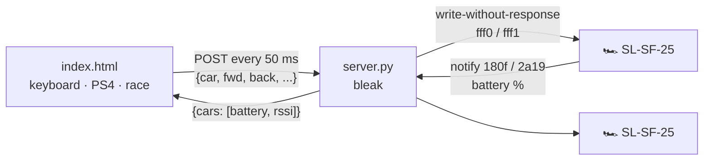

<div align="center">

# 🏎️ BlueRacing

### Race your Bburago Shell Racing Legends cars from your Mac.
**Keyboard, PS4 controller, two cars at once, and a built-in drag race. No phone needed.**


[**Get started**](#-get-started) · [How to play](#%EF%B8%8F-how-to-play) · [Drag race](#-drag-race) · [Troubleshooting](#-troubleshooting) · [Under the hood](#-under-the-hood)

</div>

---

## ✨ Why it's fun

- 🏁 **Drag race mode.** Line up two cars and run a 3‑2‑1 countdown. Both launch on the exact same command, and a scoreboard keeps the bragging rights.
- 🎮 **PS4 controller.** One person drives with the controller, another with the keyboard: two players, two cars.
- 🔵 **Plug and play.** Turn the cars on and they connect by themselves, and reconnect if one drops.
- 📊 **F1-style pit wall.** Live battery, Bluetooth signal and estimated distance for every car.
- 🛑 **Safe by default.** If the page loses contact for 0.3 s, the car stops.

## 🚀 Get started

You need a **Mac with Bluetooth**, **Google Chrome**, and at least one **Bburago Shell Racing Legends** car. A PS4 controller is optional.

**1. Install [uv](https://docs.astral.sh/uv/).** It's a tiny tool that takes care of Python for you. Open **Terminal** and paste:

```bash
curl -LsSf https://astral.sh/uv/install.sh | sh
```

**2. Download BlueRacing.** Click **Code → Download ZIP** at the top of this page and unzip it, or run:

```bash
git clone https://github.com/AurelianoBR/BlueRacing.git
```

**3. Start it** from inside the folder:

```bash
cd BlueRacing
uv run server.py
```

**4. Open http://localhost:8000 in Chrome, turn your cars on, and drive.** 🏎️

> [!NOTE]
> The first time you run it, macOS asks whether **Terminal** may use Bluetooth. Click **Allow**.

To stop, press `Ctrl + C` in the Terminal.

## 🕹️ How to play

| Action | Keyboard | 🎮 PS4 |
|---|---|---|
| Gas | `W` / `↑` | R2 · ✕ · ↑ |
| Reverse | `S` / `↓` | L2 · □ · ↓ |
| Steer | `A` `D` / `←` `→` | left stick · ← → |
| Turbo | `Shift` | R1 |
| Donut | `Space` | ○ (hold) |
| Lights | `L` | △ |
| Mode 1/2 | `M` | — |
| Pick car | `0` all · `1`…`9` | 🎮 button at the top |
| Race start | `R` | OPTIONS |

With more than one car on, the **ALL** button at the top (or keys `0`–`9`) picks which car the keyboard drives.

### 🎮 PS4 controller

1. Hold **SHARE + PS** until the light bar flashes quickly.
2. Pair it in **System Settings → Bluetooth** (it shows up as *Wireless Controller*).
3. Press any button with the BlueRacing tab focused. A **🎮** button appears at the top.

The controller drives the last car found, and clicking 🎮 switches cars. The keyboard never drives the controller's car, so two people can play without fighting.

## 🏁 Drag race

1. Line up the cars on the start line.
2. Give each car a nickname in the **DRAG RACE** panel.
3. Hit **START** (or `R` / OPTIONS). The cars wait still during 3‑2‑1, and on **GO!** they all launch at full turbo for *N* seconds (3 by default).
4. Click **WINNER** on the car that got ahead.

The cars can't report their position, so you judge the finish by eye. Nicknames and scores are saved in your browser.

## 🚗 Supported cars

| Car | Bluetooth name | Status |
|---|---|---|
| Ferrari SF-25 (F1) | `SL-SF-25` | ✅ Tested, two at once |
| Other Shell Racing Legends cars | `SL-*` | 🤞 Should work, untested |

Got another model? [Open an issue](https://github.com/AurelianoBR/BlueRacing/issues) and tell us if it works.

## 🧰 Troubleshooting

<details>
<summary><b>The page says "looking for car…" forever</b></summary>

- Close the Shell Racing Legends app on your phone. A car accepts only one connection at a time.
- Turn the car off and on again.
- Check that Terminal is allowed in **System Settings → Privacy & Security → Bluetooth**.
</details>

<details>
<summary><b>The 🎮 button doesn't appear</b></summary>

- Press a button on the controller while the BlueRacing tab is focused. Chrome hides controllers until then.
- Over USB, many cables only charge. Use a data cable or pair over Bluetooth instead.
</details>

<details>
<summary><b>The car stops when I switch tabs or windows</b></summary>

That's on purpose. Only the focused tab drives, and the car stops 0.3 s after the page goes quiet.
</details>

<details>
<summary><b><code>Address already in use</code></b></summary>

BlueRacing is already running in another Terminal window. Close that one first.
</details>

---

## 🔧 Under the hood

### Architecture



`server.py` scans continuously and connects to every device whose name starts with `SL-`. It writes the current command to each car every 50 ms, or immediately when the command changes, and stops a car whose page has been silent for 0.3 s.

Why not Web Bluetooth? It can't read RSSI once a car is connected, so a small local server bridges BLE and serves the page.

### BLE protocol

A command is **8 bytes**, written without response to characteristic `fff1` of service `fff0`:

| Byte | 0 | 1 | 2 | 3 | 4 | 5 | 6 | 7 |
|---|---|---|---|---|---|---|---|---|
| **Field** | mode `1`/`2` | forward | reverse | left | right | lights | turbo | donut |

- Every field is `0` or `1`. There is no half throttle.
- Battery uses the standard Battery Service, `180f` / `2a19`: 1 byte with the percentage, notified about every 10 s in 10% steps. Use the notifications: reading the characteristic directly returned a constant `56`.
- The level tracks battery voltage, so it dips under load, and it isn't a reliable way to tell whether the car is charging.
- The car doesn't report speed, position, steering angle or charging state.

### HTTP API

`POST /` with a JSON body:

```json
{ "car": "all", "fwd": 1, "back": 0, "left": 0, "right": 0, "turbo": 1, "donut": 0, "light": 0, "mode": 0 }
```

`car` takes `"all"`, a car id, or a list of ids. The response lists every car, with `cmd` = the 8 bytes being sent to it right now:

```json
{ "cars": [{ "id": "F36F", "name": "SL-SF-25", "connected": true, "rssi": -45, "battery": 80, "cmd": [1, 1, 0, 0, 0, 0, 1, 0] }] }
```

A car id is the last 4 characters of its macOS Bluetooth identifier.

### Files

| File | Purpose |
|---|---|
| `server.py` | Multi-car BLE bridge, HTTP server and watchdog |
| `index.html` | Pit Wall dashboard (plain HTML/CSS/JS, no build) |
| `scan.py` | Lists nearby BLE devices with their RSSI |
| `gatt.py` | Dumps a car's GATT services and characteristics |
| `probe.py` | Listens to every notification while sending an idle command |
| `drive.py` | Quick test: left, right, lights, forward, reverse for 1 s each |

The helper scripts need bleak too: `uv run --with bleak scan.py`.

## 🤝 Contributing

Issues and PRs are welcome, especially reports from other car models, Windows/Linux testing, and race modes.

## 🙏 Credits

Protocol documented by [tmk907/RacingCarsController](https://github.com/tmk907/RacingCarsController) and [jenkings/BLE-RC-Car-ESP32](https://github.com/jenkings/BLE-RC-Car-ESP32).

## 📄 License

[MIT](LICENSE) © Murilo Aureliano

<div align="center"><sub>Personal project, not affiliated with Bburago, Shell or Ferrari. If BlueRacing made you smile, drop a ⭐</sub></div>
