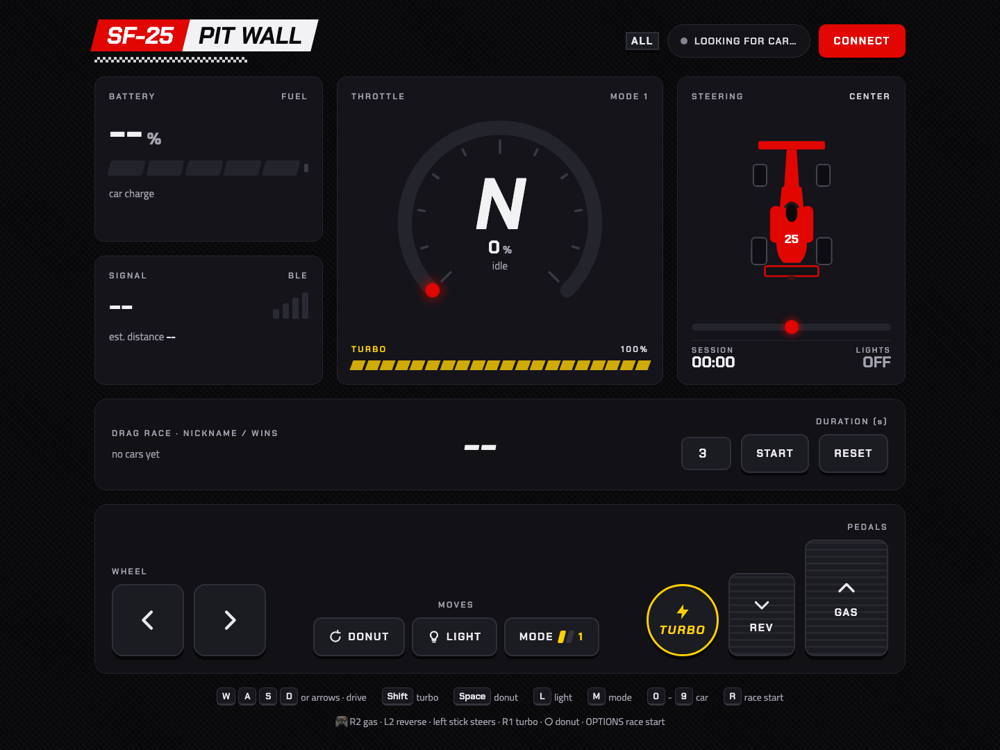
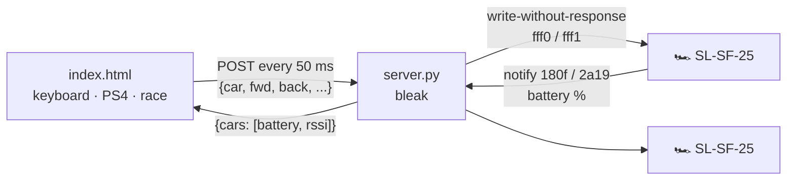

<div align="center">

# 🏎️ BlueRacing

**Drive Bburago Shell Racing Legends cars from your Mac over Bluetooth: keyboard, PS4 controller, and two-car drag races.**




</div>

---

## ✨ Features

| | |
|---|---|
| 🔵 **Multiple cars at once** | Finds and connects every `SL-*` car nearby, and reconnects if one drops. |
| ⌨️ **Keyboard** | WASD or arrow keys, turbo, donut, lights and mode, with instant response. |
| 🎮 **PS4 controller** | Drives one car while the keyboard drives the other, so two people can play. |
| 🏁 **Drag race** | 3-2-1 countdown, both cars launch together on turbo, and you pick the winner. Nicknames and scores are saved. |
| 🔋 **Telemetry** | Battery (%), BLE signal (RSSI) and estimated distance for each car. |
| 🛑 **Watchdog** | If the page stops talking to the server for 0.3 s, the car stops. |

## 🚀 Getting started

```bash
uv venv --python 3.12 .venv
uv pip install --python .venv bleak
.venv/bin/python server.py
```

Open **http://localhost:8000** in Chrome and turn the cars on. The server connects to them by itself.

> Why a server instead of Web Bluetooth? Web Bluetooth can't read RSSI once the car is connected. `server.py` (bleak) bridges BLE and serves the page.

## 🕹️ Controls

| Action | Keyboard | 🎮 PS4 |
|---|---|---|
| Gas | `W` / `↑` | R2 · ✕ · ↑ |
| Reverse | `S` / `↓` | L2 · □ · ↓ |
| Steer | `A` `D` / `←` `→` | left stick · ← → |
| Turbo | `Shift` | R1 |
| Donut | `Space` | ○ (hold) |
| Lights | `L` | △ |
| Mode 1/2 | `M` | — |
| Pick car | `0` all · `1`…`9` | 🎮 button at the top |
| Race start | `R` | OPTIONS |

The controller takes the last car found by default, and the 🎮 button switches cars. The keyboard never drives the controller's car, so the two inputs don't fight.

**Pairing the controller:** hold **SHARE + PS** until the light bar flashes, then pair it in System Settings → Bluetooth. A USB cable works too, but only if it carries data and not just power. Press any button with the page focused so Chrome exposes the controller.

## 🏁 Drag race

1. Line up the cars and give each one a nickname in the **DRAG RACE** panel.
2. Hit **START** (or `R` / OPTIONS). The cars wait still during 3‑2‑1.
3. On **GO!**, a single command wakes every car at the same time: full turbo for *N* seconds (default 3).
4. The car doesn't report its position, so you judge the winner by eye and click **WINNER** on the car that got ahead.

## 📡 BLE protocol



A command is **8 bytes** written to characteristic `fff1` (service `fff0`):

| Byte | 0 | 1 | 2 | 3 | 4 | 5 | 6 | 7 |
|---|---|---|---|---|---|---|---|---|
| **Field** | mode `1`/`2` | forward | reverse | left | right | lights | turbo | donut |

- Every field is `0` or `1`. There is no half throttle.
- Battery uses the standard `180f` / `2a19` service: 1 byte, as a percentage.
- The car doesn't report speed, position or steering angle.

## 🗂️ Files

| File | Purpose |
|---|---|
| `server.py` | Multi-car BLE bridge, HTTP server and watchdog |
| `index.html` | Pit Wall dashboard (plain HTML/CSS/JS, no build) |
| `scan.py` | Lists nearby BLE devices with their RSSI |
| `gatt.py` | Dumps a car's GATT services and characteristics |
| `probe.py` | Listens to every notification while sending an idle command |
| `drive.py` | Quick test: left, right, lights, forward, reverse for 1 s each |

## 🙏 Credits

Protocol documented by [tmk907/RacingCarsController](https://github.com/tmk907/RacingCarsController) and [jenkings/BLE-RC-Car-ESP32](https://github.com/jenkings/BLE-RC-Car-ESP32).

## 📄 License

[MIT](LICENSE) © Murilo Aureliano

<div align="center"><sub>Personal project, not affiliated with Bburago, Shell or Ferrari.</sub></div>
